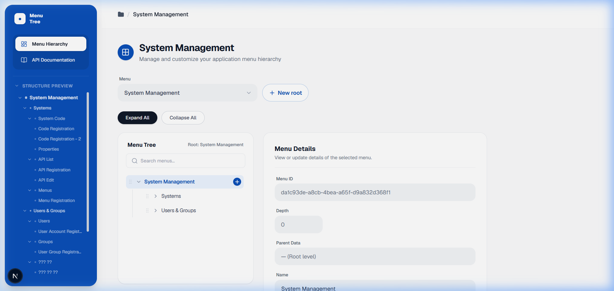
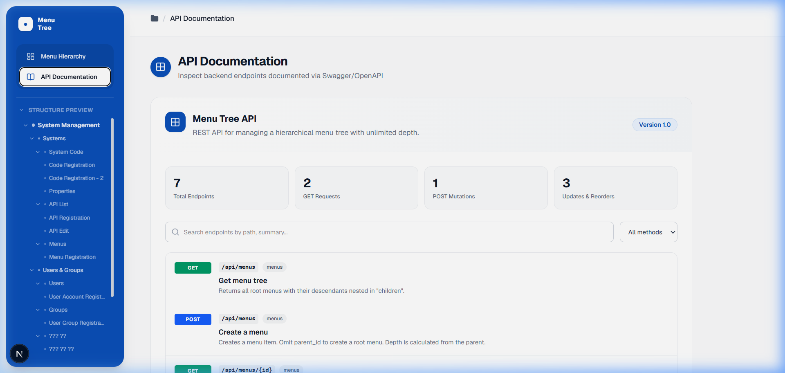

# Menu Tree — Frontend

Aplikasi web untuk mengelola hierarki menu aplikasi secara visual. Dibangun di atas **Next.js 16**, **React 19**, dan **Tailwind CSS v4**.

---

## Tampilan Aplikasi

### Halaman Menu Hierarchy

Halaman utama untuk membuat, mengedit, memindahkan, dan menghapus menu secara hierarkis dengan drag-and-drop.



### Halaman API Documentation

Halaman untuk melihat semua endpoint backend yang terdokumentasi via Swagger/OpenAPI.



---

## Tech Stack

| Kategori | Library / Tool |
|---|---|
| Framework | [Next.js 16.4](https://nextjs.org/) (App Router) |
| UI Library | [React 19](https://react.dev/) |
| Styling | [Tailwind CSS v4](https://tailwindcss.com/) |
| State Management | [Zustand v5](https://github.com/pmndrs/zustand) |
| Drag & Drop | [@dnd-kit/core](https://dndkit.com/) |
| Icons | [Lucide React](https://lucide.dev/) |
| Language | TypeScript 5 |
| Bundler | Turbopack (via Next.js) |

---

## Prasyarat

Pastikan sudah terinstal di sistem kamu:

- **Node.js** >= 18.x
- **npm** >= 9.x (atau **pnpm** / **yarn**)
- Backend API berjalan (default: `http://localhost:8080/api`)

---

## Instalasi

### 1. Clone repositori

```bash
git clone <repository-url>
cd menu-tree-frontend
```

### 2. Install dependensi

```bash
npm install
```

### 3. Konfigurasi environment

Buat file `.env.local` di root proyek:

```env
# URL base dari backend API (wajib jika bukan localhost:8080)
NEXT_PUBLIC_API_URL=http://localhost:8080/api
```

> **Catatan:** Jika variabel ini tidak diset, aplikasi akan menggunakan `http://localhost:8080/api` sebagai default.

### 4. Jalankan development server

```bash
npm run dev
```

Buka http://localhost:3000/menus di browser.

---

## Scripts

| Script | Perintah | Keterangan |
|---|---|---|
| Development | `npm run dev` | Menjalankan server development dengan Turbopack |
| Build | `npm run build` | Build production bundle |
| Start | `npm run start` | Menjalankan hasil build production |
| Lint | `npm run lint` | Menjalankan ESLint |

---

## Struktur Proyek

```
menu-tree-frontend/
├── src/
│   ├── app/
│   │   ├── layout.tsx          # Root layout (font, metadata global)
│   │   ├── page.tsx            # Redirect ke /menus
│   │   ├── globals.css         # Global CSS styles
│   │   └── menus/
│   │       └── page.tsx        # Halaman utama aplikasi
│   │
│   ├── components/
│   │   ├── layout/
│   │   │   ├── AppShell.tsx    # Layout wrapper (sidebar + header + main)
│   │   │   ├── Sidebar.tsx     # Navigasi sidebar (nav + tree preview)
│   │   │   ├── Breadcrumb.tsx  # Breadcrumb navigation
│   │   │   └── PageHeader.tsx  # Header tiap halaman
│   │   │
│   │   └── menus/
│   │       ├── MenuTree.tsx        # Komponen tree hierarki menu
│   │       ├── MenuNodeItem.tsx    # Satu item node dalam tree
│   │       ├── MenuForm.tsx        # Form Create / Edit / View menu
│   │       ├── RootMenuSelect.tsx  # Dropdown pemilih root menu
│   │       ├── TreeToolbar.tsx     # Tombol Expand All / Collapse All
│   │       ├── SearchInput.tsx     # Input pencarian menu
│   │       ├── ApiList.tsx         # Daftar endpoint API (Swagger)
│   │       ├── DeleteConfirmDialog.tsx # Dialog konfirmasi hapus
│   │       ├── EmptyState.tsx      # Tampilan ketika tree kosong
│   │       ├── ErrorBanner.tsx     # Banner notifikasi error
│   │       └── TreeSkeleton.tsx    # Skeleton loading tree
│   │
│   ├── lib/
│   │   ├── api.ts              # HTTP client & semua fungsi API call
│   │   └── tree.ts             # Utilitas manipulasi tree (find, filter, collect)
│   │
│   ├── store/
│   │   └── menuStore.ts        # Zustand store (state global menu)
│   │
│   └── types/
│       └── menu.ts             # TypeScript types (MenuNode, Menu, Swagger*)
│
├── docs/
│   ├── screenshot-menu-hierarchy.png
│   └── screenshot-api-docs.png
│
├── .env.local                  # Variabel environment (buat sendiri, tidak di-commit)
├── next.config.ts
└── tsconfig.json
```

---

## Fitur

### Menu Hierarchy (Halaman Utama)

#### Sidebar
- **2 menu navigasi tetap**: *Menu Hierarchy* dan *API Documentation*
- **Structure Preview** (read-only): menampilkan hierarki menu yang sudah dikonfigurasi secara visual di sidebar — bisa di-collapse per level

#### Area Konten

| Fitur | Keterangan |
|---|---|
| **Pilih Root Menu** | Dropdown untuk beralih antar root menu berbeda |
| **+ New Root** | Membuat menu baru di level root (tanpa parent) |
| **Expand / Collapse All** | Buka atau tutup semua node sekaligus |
| **Pencarian** | Filter node secara real-time berdasarkan nama |
| **Tambah Child** | Klik tombol `+` pada node untuk menambah sub-menu |
| **Edit Menu** | Klik nama menu untuk membuka form edit di panel kanan |
| **Hapus Menu** | Tombol delete dengan konfirmasi dialog |
| **Drag & Drop** | Pindahkan menu ke parent lain dengan drag & drop |
| **Reorder** | Ubah urutan menu dalam parent yang sama |

#### Panel Menu Details (Kanan)

Menampilkan detail menu yang dipilih:
- Menu ID (UUID)
- Depth / kedalaman level
- Parent Data
- Name (dapat diedit)

### API Documentation

- Menampilkan semua endpoint dari Swagger/OpenAPI backend
- Statistik: jumlah endpoint, GET, POST/Mutation, Update & Reorder
- Filter berdasarkan HTTP method (GET, POST, PUT, PATCH, DELETE)
- Pencarian endpoint berdasarkan path atau summary
- Expand tiap endpoint untuk melihat detail parameter dan response

---

## API Endpoints (Backend)

Aplikasi ini berkomunikasi dengan backend REST API pada `NEXT_PUBLIC_API_URL`:

| Method | Path | Keterangan |
|---|---|---|
| `GET` | `/api/menus` | Ambil semua menu sebagai tree (nested children) |
| `GET` | `/api/menus/:id` | Ambil detail satu menu |
| `POST` | `/api/menus` | Buat menu baru (`name`, `parent_id` opsional) |
| `PUT` | `/api/menus/:id` | Update nama menu |
| `DELETE` | `/api/menus/:id` | Hapus menu (beserta sub-menu jika ada) |
| `PATCH` | `/api/menus/:id/move` | Pindah menu ke parent lain |
| `PATCH` | `/api/menus/:id/reorder` | Ubah posisi urutan menu |

**Swagger UI tersedia di:** `{BASE_URL}/swagger/index.html`

### Format Error Response

```json
{
  "error": {
    "code": "NOT_FOUND",
    "message": "Menu tidak ditemukan"
  }
}
```

---

## Environment Variables

| Variabel | Default | Keterangan |
|---|---|---|
| `NEXT_PUBLIC_API_URL` | `http://localhost:8080/api` | Base URL backend API |

---

## Cara Kerja State Management

State global dikelola menggunakan **Zustand** (`src/store/menuStore.ts`):

```
tree[]          → Data seluruh menu dalam bentuk nested tree
rootId          → ID root menu yang sedang dipilih
selectedId      → ID node yang sedang dipilih di tree
expandedIds     → Set ID node yang sedang di-expand
search          → Query pencarian aktif
mode            → "view" | "add"
loading/saving  → Status loading dan saving
```

Setiap mutasi (CRUD, move, reorder) selalu memicu `fetchTree()` ulang untuk menjaga konsistensi data dengan backend.

---

## Kontribusi

1. Fork repositori ini
2. Buat branch fitur: `git checkout -b feat/nama-fitur`
3. Commit perubahan: `git commit -m "feat: deskripsi singkat"`
4. Push branch: `git push origin feat/nama-fitur`
5. Buat Pull Request

---

## Lisensi

Private — hak cipta dipegang oleh pemilik proyek.
